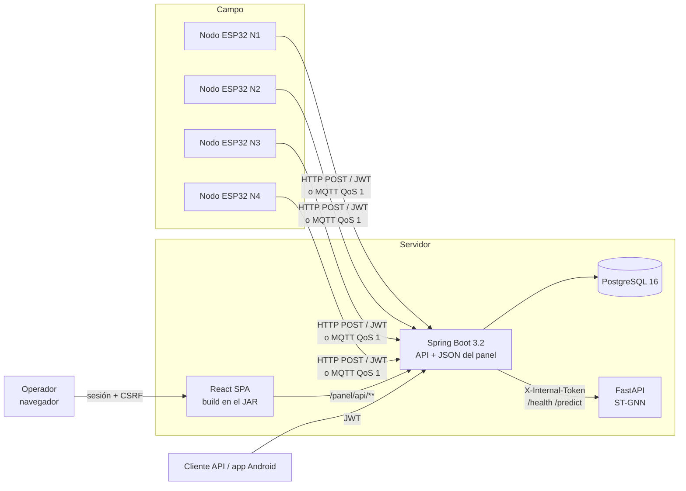
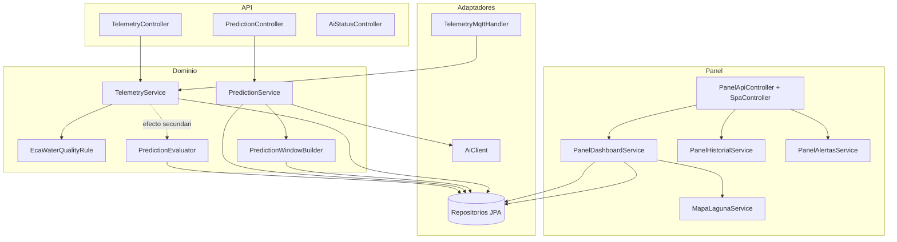
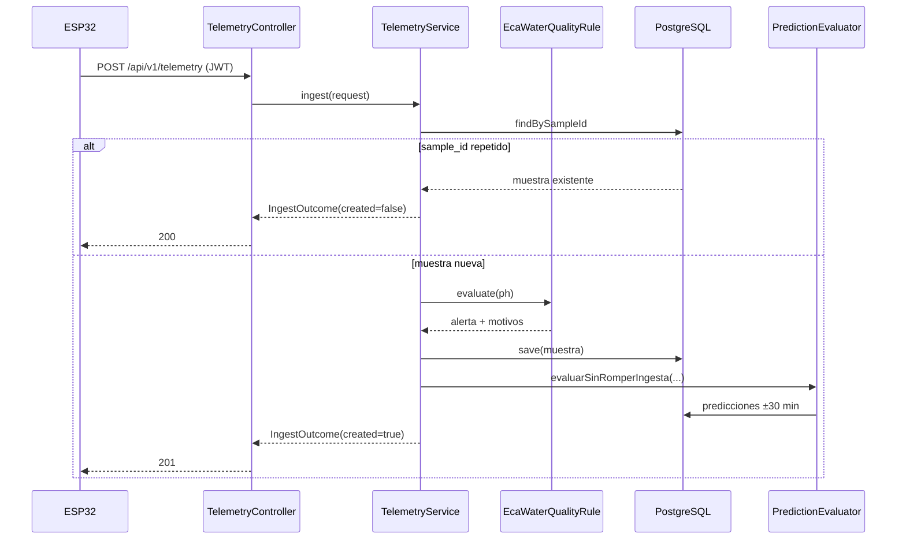
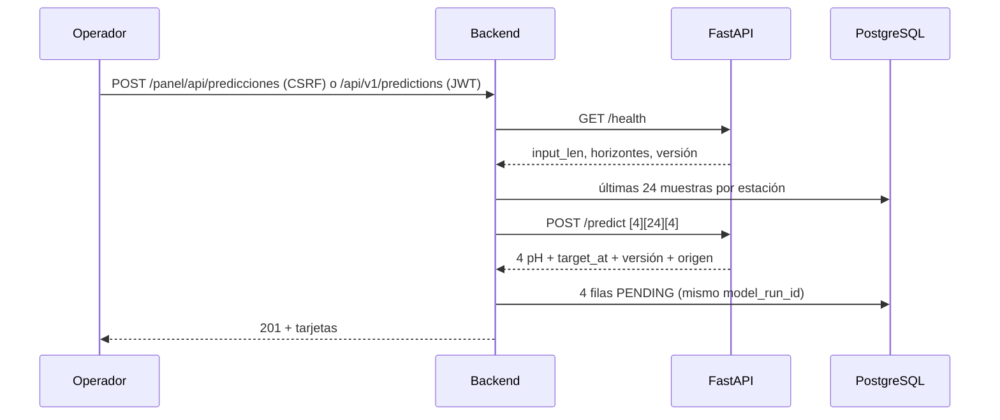
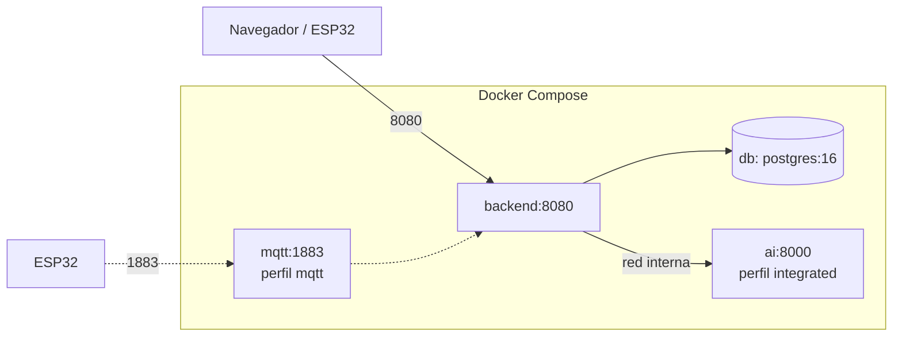

# 06 · Arquitectura del sistema

## 6.1 Vista de contexto



El backend es la **única fuente de verdad**: decide las alertas, persiste las
mediciones y es el único que escribe predicciones. El servicio de IA es un
componente interno sin acceso a la base.

## 6.2 Vista de contenedores

| Contenedor | Tecnología | Responsabilidad | Puerto |
|---|---|---|---|
| Backend | Java 21, Spring Boot 3.2 | API REST, API JSON del panel, ingesta, reglas, predicciones y servido del build React | 8080 |
| Frontend | React 19, TypeScript, Vite | SPA del panel; el build se copia al JAR y no corre como servicio aparte | — |
| Base de datos | PostgreSQL 16 | Persistencia y migraciones Flyway | 5432 |
| IA | Python 3.12, FastAPI | Inferencia del ST-GNN desde un artefacto | 8000 (interno) |
| Broker MQTT | Eclipse Mosquitto 2 | Transporte alternativo de telemetría | 1883 (perfil) |

## 6.3 Arquitectura interna del backend



### Paquetes

```
pe.edu.continental.lagunapaca
├── config/        ClockConfig
├── security/      SecurityConfig, JwtService, filtros
├── shared/api/    ApiError, GlobalExceptionHandler
├── station/       StationCatalog (N1..N4)
├── telemetry/
│   ├── api/       DTO y controlador REST
│   ├── domain/    WaterQualitySample, AlertReason, repositorio, specs
│   ├── service/   TelemetryService, EcaWaterQualityRule, IngestOutcome
│   └── mqtt/      handler y propiedades
├── prediction/
│   ├── api/       DTO y controladores
│   ├── client/    AiClient, AiProperties, payloads
│   ├── domain/    Prediction, PredictionRepository, estado
│   └── service/   PredictionService, WindowBuilder, Evaluator, errores
└── panel/         API JSON, SPA, servicios de vista y modelos
```

El frontend vive fuera del backend, en `frontend/`:

```
frontend/
├── src/api/        cliente CSRF/fetch y tipos del contrato
├── src/components/ componentes reutilizables
├── src/hooks/      sesión, tema y toasts
├── src/pages/      acceso, tablero, métricas, historial y alertas
├── src/styles/     tokens y CSS de la SPA
└── src/test/       Vitest + Testing Library
```

### Reglas de dependencia

- `panel` puede leer repositorios y `prediction.service`, pero **no** llama a
  los controladores de la API.
- El frontend consume **`/panel/api/**`**, no `/api/v1`; así no necesita un JWT
  en `localStorage` y conserva la sesión con CSRF.
- `telemetry` no depende de `prediction.client`: la ingesta nunca espera a la
  IA. Solo depende de `PredictionEvaluator`, que absorbe sus errores.
- `prediction` no importa `panel`.
- `shared` no importa dominio.

## 6.4 Flujo de una medición



## 6.5 Flujo de una predicción



## 6.6 Decisiones estructurales

| Decisión | Alternativa descartada | Motivo |
|---|---|---|
| Monolito modular Spring Boot | Microservicios separados | Un solo JAR simplifica la demo y la tesis; los límites son de paquetes, no de red |
| PostgreSQL + Flyway | TimescaleDB | El volumen de la tesis no justifica una extensión; se documenta cuándo sí |
| Sin Neo4j | Grafo en memoria | El grafo tiene 4 nodos y se construye determinísticamente; Neo4j añadiría un servicio sin aportar |
| SPA React + API JSON | Thymeleaf renderizado en servidor | Mejor separación, estados de carga y refresco sin recargar; el build se sirve desde el JAR y la demo sigue sin Node |
| FastAPI separado | Cargar PyTorch en la JVM | Python es el entorno natural del modelo; el contrato HTTP aísla versiones |
| `java.net.http.HttpClient` | Feign/WebClient | Sin dependencias nuevas y con timeouts explícitos |
| Predicción en tabla propia | Columna en la muestra | Una predicción no es una medición y debe evaluarse después |
| `sample_id` opcional | Obligatorio | No rompe a los clientes existentes y permite idempotencia cuando el nodo lo envía |

## 6.7 Despliegue lógico



La IA no publica puerto al host: solo el backend la alcanza por la red de
Compose. Ver `15-despliegue.md`.
