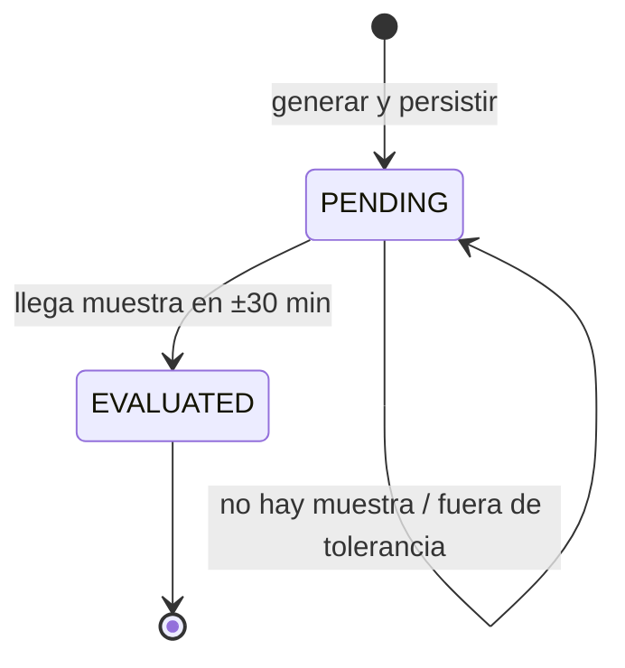

# 07 · Modelo de dominio

## 7.1 Entidades

### WaterQualitySample (muestra)

Representa una medición **observada** por un nodo. Es la unidad de verdad
ambiental.

| Atributo | Tipo | Invariante |
|---|---|---|
| `id` | Long | Identidad técnica |
| `nodeId` | String(32) | Obligatorio; `N1`…`N4` en la práctica |
| `ph` | double | 0.0 … 14.0 (validado en el DTO) |
| `turbidityNtu` | double | ≥ 0 |
| `tempC` | double | −5 … 60 |
| `tdsPpm` | double | ≥ 0 |
| `recordedAt` | Instant | Lo asigna el servidor, nunca el nodo |
| `alert` | boolean | Veredicto ECA-Agua persistido |
| `alertReasons` | List<AlertReason> | Vacío si `alert = false` |
| `sampleId` | String(64), opcional | Único cuando está presente |
| `acknowledgedAt/By/Note` | varios | Auditoría de atención, independiente del veredicto |

**Invariante central:** `alert` y sus motivos se calculan **una sola vez** en la
ingesta y no se recalculan en el panel. Si se recalculara el pH en la vista
habría dos reglas ECA-Agua que podrían divergir.

### AlertReason (motivo)

| Atributo | Tipo | Invariante |
|---|---|---|
| `code` | `PH_LOW` \| `PH_HIGH` | Único por muestra |
| `message` | String | Texto legible con el valor medido |

### Prediction (predicción)

Representa un valor **previsto**, no medido.

| Atributo | Tipo | Invariante |
|---|---|---|
| `id` | Long | Identidad técnica |
| `modelRunId` | UUID | Agrupa las cuatro estaciones de una inferencia |
| `nodeId` | String(32) | Estación |
| `variable` | String(16) | Hoy solo `ph` |
| `horizonHours` | int | > 0; el artefacto soporta 1, 3, 6 |
| `generatedAt` | Instant | Cuando el backend persistió la predicción |
| `targetAt` | Instant | Debe ser posterior a `generatedAt` |
| `predictedValue` | double | **Inmutable** una vez guardado |
| `modelVersion` | String(64) | Identifica el artefacto |
| `dataSource` | `synthetic` \| `field` | Origen de los datos de entrenamiento |
| `status` | `PENDING` \| `EVALUATED` | Máquina de estados |
| `observedValue` | Double | Solo si `EVALUATED` |
| `error` | Double | `predicho − observado`, solo si `EVALUATED` |
| `evaluatedAt` | Instant | Solo si `EVALUATED` |

## 7.2 Máquina de estados de una predicción



No existe transición de `EVALUATED` a `PENDING`: una evaluación es evidencia.
Si se quisiera corregir, se registraría otra predicción, no se reescribiría la
historia.

## 7.3 Regla ECA-Agua

Categoría 4-E1 (agua para conservación del ambiente acuático), pH:

```
alerta = ph < 6.5  ó  ph > 9.0
```

Los valores **exactamente** 6.5 y 9.0 están dentro del rango. Hay un test que
fija ese borde porque es la clase de detalle que se rompe al «simplificar» una
comparación.

Los motivos se redactan con dos decimales y el límite:

- `PH_LOW`: «pH 6.20 está por debajo del límite inferior ECA-Agua (6.5)»
- `PH_HIGH`: «pH 9.70 supera el límite superior ECA-Agua (9.0)»

## 7.4 Objetos de valor

- `IngestOutcome(TelemetryResponse, created)`: distingue 201 de 200 sin
  inspeccionar la base desde el controlador.
- `PredictionWindow(estaciones, inputLen, baseTime, valores[4][T][4])`: ventana
  de inferencia. Si falta historia, se lanza `IncompleteWindowException` en vez
  de rellenar con ceros.
- `AiPredictionResult`: respuesta ya validada del servicio de IA.
- `AiStatusResponse`: estado del servicio, con `available` y `detail`.

## 7.5 Por qué no hay una entidad «Estación»

`StationCatalog` es una constante (`N1`…`N4`) porque todavía no hay atributos de
estación en la base (nombre, coordenadas, fecha de instalación). Crear una tabla
con cuatro filas sin datos reales sería una entidad anémica. Cuando existan
coordenadas medidas en campo, la entidad tendrá sentido y el catálogo se
reemplazará sin tocar el modelo del grafo.

## 7.6 Agregados y transacciones

- La muestra y sus motivos son un agregado: se guardan juntos.
- La predicción es un agregado independiente; las cuatro filas de una ejecución
  comparten `modelRunId`, pero no se modifican juntas.
- La evaluación corre en `REQUIRES_NEW` para que un fallo al evaluar no marque
  como rollback la transacción de ingesta.
- La llamada HTTP a la IA **no** ocurre dentro de una transacción: una espera de
  hasta 15 s no debe retener una conexión a la base.
