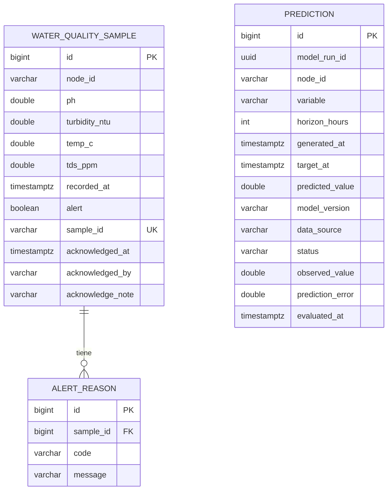

# 08 · Modelo de datos

## 8.1 Motor y migraciones

- PostgreSQL 16 en producción; H2 en memoria solo para pruebas y perfil `demo`.
- Flyway gobierna el esquema (`spring.jpa.hibernate.ddl-auto=validate`).
- Migraciones actuales: **V1 … V5**, contiguas y aditivas.
- `FlywayMigrationsTest` verifica que no haya huecos, duplicados ni operaciones
  destructivas en V5. **No sustituye** una prueba contra PostgreSQL real: esa
  queda pendiente por no haber Docker en la máquina.

## 8.2 `water_quality_sample`

| Columna | Tipo | Notas |
|---|---|---|
| `id` | BIGSERIAL | PK |
| `node_id` | VARCHAR(32) | NOT NULL |
| `ph` | DOUBLE PRECISION | NOT NULL |
| `turbidity_ntu` | DOUBLE PRECISION | NOT NULL |
| `temp_c` | DOUBLE PRECISION | NOT NULL |
| `tds_ppm` | DOUBLE PRECISION | NOT NULL |
| `recorded_at` | TIMESTAMPTZ | NOT NULL, asignado por el servidor |
| `alert` | BOOLEAN | NOT NULL |
| `sample_id` | VARCHAR(64) | NULL (V5), único cuando no es nulo |
| `acknowledged_at` | TIMESTAMPTZ | NULL (V4) |
| `acknowledged_by` | VARCHAR(120) | NULL (V4) |
| `acknowledge_note` | VARCHAR(500) | NULL (V4) |

Índices:

- `idx_wqs_node_recorded_at (node_id, recorded_at DESC)`: consulta del histórico
  y de la ventana de inferencia.
- `ux_water_quality_sample_sample_id (sample_id) WHERE sample_id IS NOT NULL`:
  idempotencia. Es **parcial** para que las muestras históricas sin
  identificador no colisionen entre sí (en PostgreSQL varios `NULL` son
  distintos).
- `idx_wqs_alert_acknowledged_at`: alertas pendientes/atendidas.

## 8.3 `alert_reason`

| Columna | Tipo | Notas |
|---|---|---|
| `id` | BIGSERIAL | PK |
| `sample_id` | BIGINT | FK a `water_quality_sample` |
| `code` | VARCHAR(20) | `PH_LOW` / `PH_HIGH` |
| `message` | VARCHAR | Texto redactado por el backend |

Restricción `uq_alert_reason (sample_id, code)`: una muestra no puede repetir el
mismo motivo.

## 8.4 `prediction` (V5)

| Columna | Tipo | Notas |
|---|---|---|
| `id` | BIGSERIAL | PK |
| `model_run_id` | UUID | Agrupa las cuatro estaciones |
| `node_id` | VARCHAR(32) | Estación |
| `variable` | VARCHAR(16) | `ph` |
| `horizon_hours` | INTEGER | > 0 |
| `generated_at` | TIMESTAMPTZ | |
| `target_at` | TIMESTAMPTZ | > `generated_at` |
| `predicted_value` | DOUBLE PRECISION | Inmutable |
| `model_version` | VARCHAR(64) | |
| `data_source` | VARCHAR(16) | `synthetic` / `field` |
| `status` | VARCHAR(16) | `PENDING` / `EVALUATED` |
| `observed_value` | DOUBLE PRECISION | NULL si pendiente |
| `prediction_error` | DOUBLE PRECISION | NULL si pendiente |
| `evaluated_at` | TIMESTAMPTZ | NULL si pendiente |

Restricciones:

- `ck_prediction_horizon`: `horizon_hours > 0`.
- `ck_prediction_target`: `target_at > generated_at`.
- `ck_prediction_status`: solo dos estados.
- `ck_prediction_evaluation`: o están los tres campos de evaluación, o ninguno.
  Evita estados a medias que luego hay que interpretar en el código.

Índices:

- `(status, target_at)`: barrido de pendientes.
- `(node_id, target_at)`: evaluación por estación.
- `(generated_at DESC)`: últimas predicciones del tablero.
- `(model_run_id)`: auditoría de una ejecución.

## 8.5 Diagrama

`prediction` **no** tiene FK a `water_quality_sample`: la evaluación encuentra
la muestra por estación e instante, y una predicción puede quedar sin muestra
(no llegó el nodo). Una FK obligaría a inventar una fila.

## 8.6 Política de migraciones

1. Una migración nueva no modifica ni borra las anteriores.
2. Los cambios destructivos requieren una migración de dos pasos (agregar,
   migrar datos, eliminar) y una ventana de mantenimiento.
3. `V5` es aditiva: añade columna, índice y tabla.
4. En tests con H2, Flyway se desactiva y Hibernate crea el esquema desde las
   entidades. Eso verifica el mapeo, **no** el SQL de PostgreSQL.

## 8.7 Retención y respaldo (propuesta operativa)

- Las mediciones no se borran: son la evidencia de la tesis.
- Respaldo diario con `pg_dump` y retención de 30 días; el detalle está en
  `16-operacion-y-observabilidad.md`.
- Las predicciones se pueden archivar por año si el volumen crece; hoy no se
  justifica.

## 8.8 Por qué no TimescaleDB ni Neo4j

- **TimescaleDB**: útil con millones de muestras y consultas de agregación
  temporales. Con cuatro nodos cada 15 minutos (~140 k muestras/año), una tabla
  con índice compuesto es suficiente. Si el proyecto crece a decenas de nodos y
  años de historia, la hypertable sería razonable.
- **Neo4j**: el grafo tiene cuatro estaciones y se construye con una matriz de
  distancias. Guardarlo en un motor de grafos añadiría un servicio, credenciales
  y latencia sin mejorar el modelo. Si se incorporaran decenas de cuerpos de
  agua con relaciones complejas, se justificaría.
