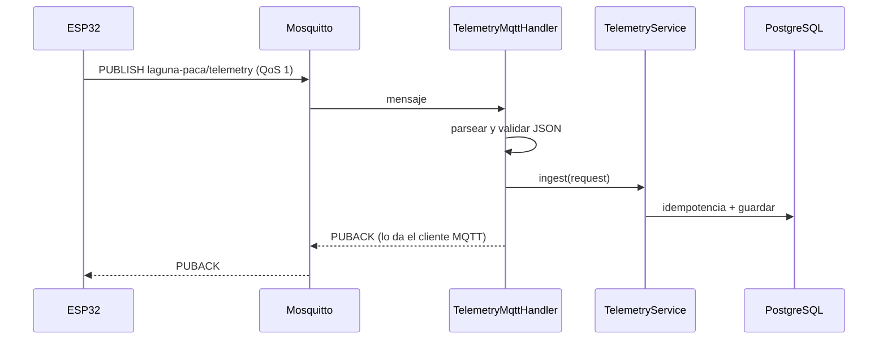

# 13 · Ingesta MQTT

## 13.1 Rol

Segunda vía de telemetría, además del `POST /api/v1/telemetry`. Sirve cuando el
nodo no puede (o no debe) hacer HTTP con JWT: por ejemplo, una red con broker
local y muchos nodos.

## 13.2 Configuración

| Variable | Por defecto | Descripción |
|---|---|---|
| `MQTT_ENABLED` | `false` | Sin esto, la app arranca sin broker |
| `MQTT_BROKER_URL` | `tcp://localhost:1883` | URL del broker |
| `MQTT_CLIENT_ID` | `laguna-paca-backend` | Id del cliente backend |
| `MQTT_USERNAME` | vacío | Credenciales del broker |
| `MQTT_PASSWORD` | vacío | Credenciales del broker |
| `MQTT_TOPIC` | `laguna-paca/telemetry` | Debe coincidir con el firmware |
| `MQTT_QOS` | `1` | Al menos una entrega |
| `MQTT_TIMEOUT_MS` | `5000` | Espera de la operación |

La app arranca sin broker porque `MQTT_ENABLED=false` por defecto. Los tests del
handler no necesitan broker: se prueba la unidad aislada.

## 13.3 Flujo



- **No usa JWT**: se autentica con las credenciales del broker. El topic no es
  público en producción; en `deploy/mosquitto.conf` el modo anónimo es solo para
  desarrollo.
- El payload es **el mismo** del ESP32, incluido `sample_id`.
- Un JSON inválido se descarta con `WARN` sin detener el consumidor.
- Un duplicado por reentrega QoS 1 sigue siendo idempotente si el nodo envía
  `sample_id`.
- La evaluación de predicciones también ocurre por esta vía, porque el handler
  llama al mismo `TelemetryService`.

## 13.4 QoS y cliente

- El backend se suscribe con QoS 1.
- El firmware publica con QoS 1 (`256dpi/MQTT`). PubSubClient **no** sirve porque
  solo publica con QoS 0: el nodo daría la muestra por entregada sin esperar al
  PUBACK.
- El client id del backend es fijo y configurable; el del nodo incluye la MAC
  para que dos nodos no colisionen.

## 13.5 Broker de desarrollo

`deploy/mosquitto.conf`:

```
listener 1883
allow_anonymous true
persistence true
persistence_location /mosquitto/data/
```

**Solo desarrollo.** En producción:

1. crear usuarios con `mosquitto_passwd`;
2. desactivar `allow_anonymous`;
3. usar TLS (8883) con certificados;
4. restringir el topic por usuario si hay varios conjuntos de nodos.

## 13.6 Diferencias con HTTP

| Aspecto | HTTP | MQTT |
|---|---|---|
| Autenticación | JWT del backend | Credenciales del broker |
| Confirmación | Código 201/200 | PUBACK |
| Reintento | El nodo decide | El broker puede reentregar |
| Firewall | Puerto 8080 | Puerto 1883/8883 |
| Flash del nodo | Mayor (`HTTPClient` + TLS) | Menor |
| Depuración | `curl`, Swagger | `mosquitto_sub` |

## 13.7 Pruebas

- `TelemetryMqttHandlerTest`: payload válido, inválido, duplicado, y que un fallo
  no propague una excepción que tumbe al consumidor.
- Firmware: `test_mqttClientId_*` y el build `esp32dev-mqtt`.
- **No ejecutado**: integración real contra Mosquitto (no hay Docker en la
  máquina). Se documenta como pendiente en `26-limitaciones.md`.
